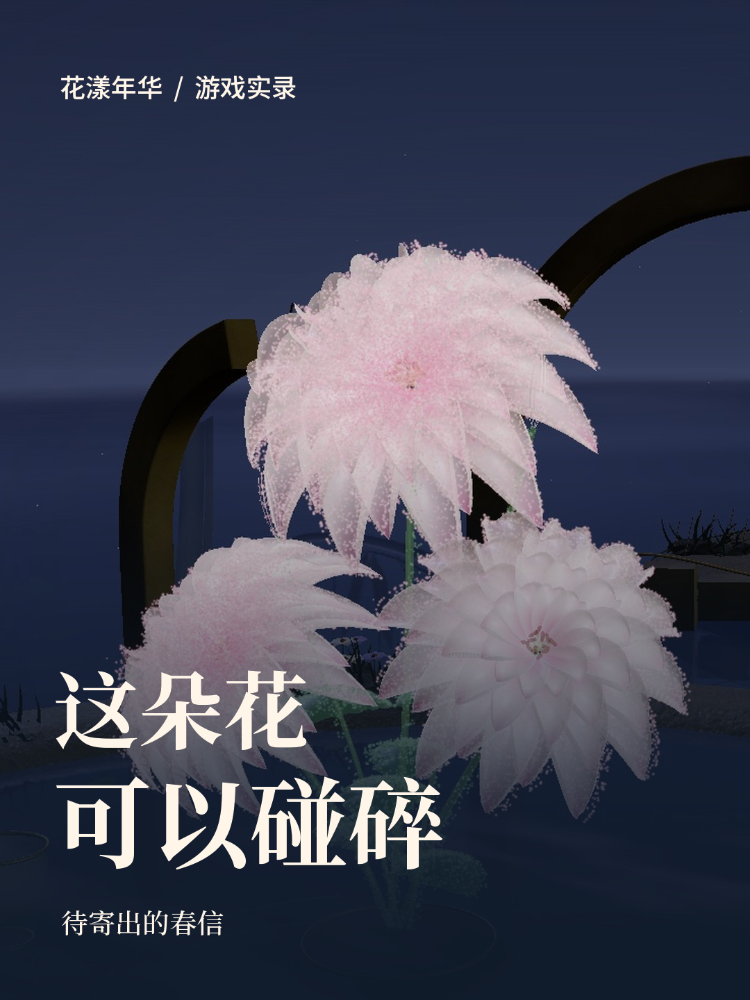

# 花漾年华 · 待寄出的春信

风暴过去，守园人留下几封没有回音的信。你是送春者弥。让花在指尖散成尘，穿过雨幕温室，在沉星天文台接回前人的一封信，再把自己的话带到海上。

[](spring-letter-promo/首发物料/01-春信-真实游玩宣传片.mp4)

**0.9.1** 是一个可在桌面浏览器游玩的三维艺术探索游戏。旅途包含情境序章、十二个主要环节和扬帆终章。扉页的「花与花尘」也可以单独游玩，试试四种花形、五种光色，以及花尘随笔势漂游再缓缓复原的变化。

## 下载与游玩

| 我想…… | 从这里开始 |
| --- | --- |
| 在 Windows 上玩 | [Windows 包](spring-letter/releases/spring-letter-0.9.1-windows.zip)。解压后运行 `启动春信.cmd`，需要本机安装 Node.js。 |
| 部署到静态网站 | [浏览器包](spring-letter/releases/spring-letter-0.9.1-browser.zip)。解压后，将含 `index.html` 的目录交给静态 HTTP 服务。 |
| 看实机画面 | [35 秒实机宣传片](spring-letter-promo/首发物料/01-春信-真实游玩宣传片.mp4) · [九件首发物料](spring-letter-promo/首发物料) · [整包下载](spring-letter-promo/春信-小红书首发物料.zip) |
| 查找图片、声音或原片 | [资产索引](ASSETS.md) · [外部素材来源](spring-letter/ASSET_SOURCES.md) · [发行文件校验值](SHA256SUMS.txt) |

GitHub 的大文件页面可用 **Download raw file** 下载。本地直接启动仓库内的发行版本，只需 Node.js，在仓库根目录运行以下命令，然后打开终端显示的地址。

```sh
node spring-letter/scripts/serve.cjs
```

## 源码与开发

发行版本使用 Three.js 和 Vite，锁文件在游戏目录内。建议使用 Node.js 24。

```sh
cd spring-letter
npm ci
npm run dev
```

`npm run build` 生成静态网站。`npm test` 运行回归测试。完整的历史录制工具测试使用 Windows 版 Playwright FFmpeg。可在游戏目录的 PowerShell 中执行一次以下安装。

```powershell
$env:PLAYWRIGHT_BROWSERS_PATH = Join-Path (Get-Location) '.tools/playwright'
npx playwright install ffmpeg
npm test
```

要校验下载或克隆后的发行文件，请在仓库根目录运行 `node tools/verify-release.mjs`。校验无需安装依赖。

[游戏操作与章节介绍](spring-letter/README.md) · [地图与叙事设计](docs/blossom/v12-design.md) · [发行验收](spring-letter/FINAL_QA.md) · [项目许可证](LICENSE) · [第三方许可](spring-letter/THIRD_PARTY_LICENSES.md)
