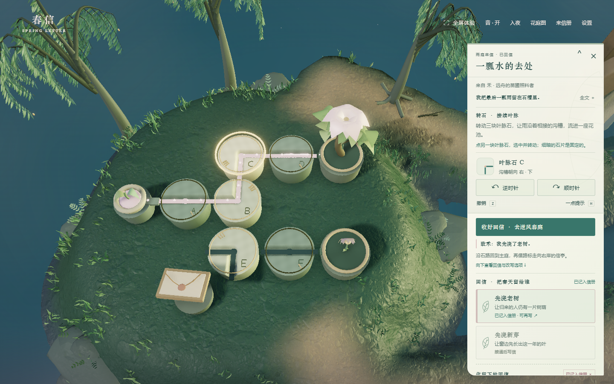
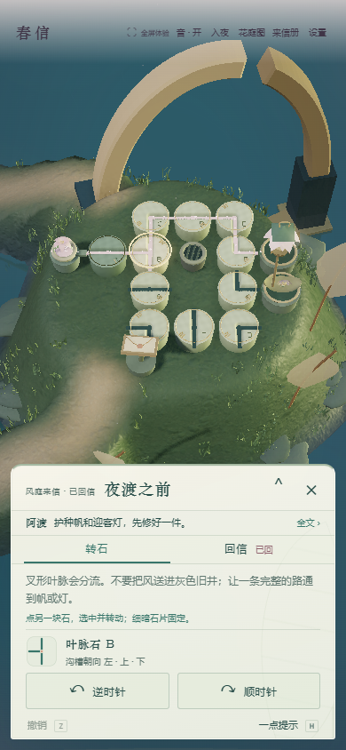

# 《花漾年华：待寄出的春信》0.6 产品体验复核

审阅日期：2026-11-21。对象：三庭来信 → 花桥 → 种核 → 寄信。方法：复核本任务明确指定的实机截图、保留的普通输入报告与当前源码；采用 `product-design:audit` 的逐步证据和限制记录方式。按任务要求没有开启浏览器、没有重新操作游戏，也没有访问用户正在玩的页面。本文只新增这份文档，没有修改源码。

**判断：三庭已经形成可玩的规则与结果链，主要欠缺的是每一段的“动机—完成—下一步”交接。** 不宜再用增加菜单、转子数量或长篇说明来解决。优先让来信在正确时机被看见，让回信之后有具体去处，让选择中的声音和文字与实际行为一致。

这里的“问题”不是虚构的用户反馈：下文将截图/代码事实、产品风险推断、待真人验证分开。陌生玩家是否觉得好玩、愿意继续或愿意购买，仍未得到证明。

## 复核的旅程与证据

| 步骤 | 观察对象 | 当前健康度与边界 |
|---|---|---|
| 1 | 进入雨庭，阅读第一封信，转第一块石 | 桌面棋盘清楚，动作与出口同屏；需改善从“转当前石”到“选择另一块石”的首次发现 |
| 2 | 雨庭接通并确认照料 | 预览与确认分离，结果会保存；完成后的前往风庭交接较泛 |
| 3 | 风庭避开旧井，点灯或护帆 | 规则确实增加止漏条件；奖励文案存在与点灯选择矛盾的一句 |
| 4 | 潮庭双源汇合，选择旧曲或新声 | 规则区别于前两庭，结尾认领真实选择；两个声音选择尚无不同的编曲响应 |
| 5 | 离开潮庭，回旧台编桥 | 普通输入测试已经走通，不是无法通关；测试脚本知道坐标，不能证明陌生玩家能发现交接 |
| 6 | 两种核安放、预览、寄出、回看 | 结尾截图明确复述三个实际选择；保存/反悔逻辑另有工程验证，不应为了更“电影化”去掉这些保护 |
| 7 | 390×844 触屏转石与回信 | 棋盘与两项选择可见，页签避免拥挤；寄信人和愿望落到了转石首屏的滚动下方 |

主要可视证据：

版本限制：结尾与完整路由图来自 proto-a；`third-look` 与上述手机图来自较后的 proto-c。本文没有把不同候选拼成“同一最终版已验收”。手机报告最后失败于旧候选的存档摘要断言，错误列表为空；它不是触屏崩溃或新的存档缺陷证据。旧 proto-a 图中纸面下方选择被截断的问题，已由较后的固定出口区/手机页签改善，不重复列为当前缺陷。后续修改必须在最终冻结构建重新截图确认。

## 本轮最值得处理的五件事

### 1. 回信后给出具体下一程，尤其是潮庭到花桥

**事实。** `letter-controller.js` 的 `commit()` 只设置“你的回信已经留下。可以停一会儿，也可以继续上路。”。`main.js:onGardenReply()` 发送的正文字幕会被 `body.letter-focus #caption` 隐藏。退出近看后，尚有未回信庭院时追踪器会自动换目标；三庭完成后不再有来信目标。靠近已完成信台时，`letter-led` 仍会隐藏旧的 `#world-guide`。这不是流程死锁：走远后旧引导可重新显示，熟悉路线的脚本也已通过。

**风险推断。** 玩家在刚获得“我完成了”的时刻，先看到的是还可以重选的操作区，具体旅程交接要靠关闭、移动、发现另一个系统。潮庭到花桥的输入语法也由转石变为写风，最需要一次清楚交接。

**小范围改法。** 回信下方给一条不占领棋盘的下一步：雨庭“收好回信，去风庭”；风庭“收好回信，去潮庭”；潮庭“收好回信，回旧台织桥”。点击只收起信纸并追踪/显示下一目标，不替玩家走路或解题。能力用一句具体操作说明承接，例如“打开来信册，可乘花尘回到已经照料的庭院”。全庭已回信但桥未完成时，离开潮庭立即显示旧台方向和写风操作。

**验收。** 每庭首次回信后，手机与桌面不用滚到无提示的空白区就能看到下一步；潮庭按钮不跳过桥、不改变桥状态；回看旧庭仍保留重选。真人测试只问“你接下来想做什么”，不要提示旧台位置。

### 2. 手机首屏先给一个人的愿望，再给转石工具

**事实。** 手机 CSS 把 `.letter-origin` 排为 `order:3`，规则与工具分别是 `order:1/2`。已查看的 `wind-turn.png` 首屏显示“叉形叶脉会分流”、石 B 与转动按钮；寄信人、原文摘要在面板滚动下方。来信仍可滚动访问，不是内容丢失。

**风险推断。** 如果玩家先接触“规则与旋转”而未看到“阿渡在等靠岸的人”，游戏更容易被理解为三个换背景的机关。这个风险正好削弱作品区别于普通管道解谜的叙事卖点。

**小范围改法。** 在手机共同的标题区保留寄信人和一句短愿望/“读来信”入口；正文仍可折叠或在同一纸面展开。保留“转石 / 回信”两页的短操作区，避免为了完整长文重新压住棋盘。不要在首次完成后强制跳回说明。

**验收。** 390×844 未滚动首屏能回答“谁希望我先照料什么”；两种照料选择、转动、撤销、关闭仍可达。正文展开不把触控目标推到屏幕外，关闭后不丢滚动和石片选择。

### 3. 明示“可以直接点另一块石”，不要把基本入口折叠起来

**事实。** 桌面雨庭默认选中 B；首屏有逆/顺时针两个按钮和方向图。具体的“点画面中的石头转动”在默认收起的 `#letter-help` 中，字母选择器也在其中。`main.js` 的 letter 模式 `pointermove` 直接返回，没有石片 hover 提示。直接点三维石片的实现存在，已知路由测试能操作它。

**风险推断。** 初次玩家可能以为只能反复转 B，或者把画面当展示而继续寻找菜单。不能用自动化能点中来证明此入口已被玩家发现。

**小范围改法。** 在选石方向图旁或规则下面常驻一句：“点另一块叶脉石，选中并转动。固定石不能转。”桌面可补可转石的轻微描边或指针反馈；不要把整张棋盘变成按钮网格。完整键盘说明和字母选择器仍保留在折叠区。

**验收。** 首屏不展开帮助即可读到直接操作提示；触屏点另一块确实切换并只转一次；点固定石不会误导为成功操作。真人记录第一次尝试换石的动作，不提前口头解释。

### 4. 风庭的奖励说明不能把“点灯”写成“已经修帆”

**事实。** `letter-model.js` 对两种风庭选择共用奖励：“修好的风帆会记住路：可以在已回信的春庭之间往返。”但 `lamp` 回信说“等下一艘船靠岸，就一起把帆缝好吧。”，即帆尚待修好。两种选择共用能力是有意设计；文案对行动的归因有矛盾。

**风险推断。** 即使只是一句，玩家会发现作品没有准确记住自己刚选的对象；这比增加更多诗句更伤害选择的可信度。

**小范围改法。** 用中性的世界回应：“这阵风记住了来路。打开来信册，可以在已经照料的庭院之间往返。”或者为 `lamp` 和 `sail` 写不同的获益缘由，共用相同能力，不改经济和存档模型。

**验收。** 灯与帆两个选择、回访重选、来信册、结尾相关文字都不声称玩家完成另一件事情；能力仍相同，不出现为了奖励而选某一边的隐含正确答案。

### 5. 潮庭“听完旧曲 / 留出新声”需要可辨别的声音回应

**事实。** 纯数据比较 `scoreBar(0…15, {zone:'pool',letter:'tide',letterConnected:true,letterChoice:'old'/'new'})` 得到 **16/16 小节完全相同**。当前 `scoreBar()` 只把 `letterChoice` 当真假值；`audio-engine.js` 的 `letter-reply` 也只按 `payload.id` 选动机，不用 `choice`。本文没有试听，也没有把这说成音质问题。现有三庭配器彼此不同，潮庭双泉也有左右声部，这些是已经存在的基础。

**风险推断。** 潮庭的选择直接以“声音”命名，实际可见变化和文字变化却承担了全部差别。“为新的一声留一拍”值得成为玩家可听到、可观察到的行动结果。

**小范围改法。** 用同一短动机做两种节奏：旧曲由两声部在末拍合奏；新声先停半拍，再由另一音色回应。提交时只播放一次短回应，回访时可明确再次倾听。可让被选花铃与声部同步轻动；轻缓动态仍能听到差别。不需要新增长音乐、配音、随机音符或更大音量。

**验收。** 两选择产生不同的确定性节拍/音色事件，暂停、静音与反复提交不叠加无限声源；分别录同一花庭的两种选择以供实际听审。真人只问“你听到两种回应有什么不同”，不以自动数据差异代替听感判断。

## 已经成立、应保留的部分

- 三庭不是完全同一个条件：雨庭分路、风庭止漏、潮庭双源汇合，在规则模型与实际截图中都能区分。
- 接通是预览，回信是明确选择；环境生长和原选择可以继续保留，尝试别的路线不会立即抹去上一次照料。
- 已查看结尾明确提及新芽、迎客灯和新声，个人选择没有被泛化结语覆盖。
- 桌面右侧纸面与手机版页签在较新截图中保留了棋盘，不必再加一个全屏任务页。
- 导出、备份、重选与留步不是“机械感”的根源，它们保护玩家投入，应保留清楚、安静的入口。

## 仍需真人和最终版本确认

本轮最优先验收顺序是 1 → 2 → 3；4 是小文案修正；5 是艺术互动增益。建议先做完并对同一候选复测，再增加新机关。建议本身不等于已修改完成，最终实施状态由 root 的新截图与记录确认。

没有从截图推出点击成功率、阅读率、留存率、满意度或购买意愿。文字对比度、屏幕阅读器、真实手机性能、听觉感受也没有在本次静态复核中获得完整验证。触控目标在截图可见不等于所有设备都足够易点；当前只能把这些保留为后续观察项。

商业判断应继续使用已有 [试玩档案](v8-product-release.md) 的 8–12 人方案：观察能否独立换石、首庭后能否说出下一个目的地、是否记得自己照料了谁、能否解释潮庭两种声音的区别。前述改进可让这次测试更有意义，不能替代测试本身。

## 修复进度：release-c 候选

追加日期：2026-11-21。以上审阅正文与当时截图作为历史事实保留，不倒改成“问题从未发生”。下表记录后续源码与冻结候选的变化；本次追加仍未开启浏览器、没有人工试听。release-c 的最终主线、窄屏截图及音频证据正在统一归档，因此下表的“已实现”不是宣布最终验收通过。

| 原审阅项 | 后续实现 | 还需要确认 |
|---|---|---|
| 1. 回信之后的下一程 | `letterNextStep()` 为雨、风、潮的完成提供具体去向；回信区置顶按钮、回信首句与路线说明。潮庭完成后 `letter-controller` 追踪旧石台，`letter-wayfinding` 沿可行走陆路导航；点击按钮只退出信纸，不代替走路或织桥。来信册的显式回访追踪也不会被自动换到下一封信 | 同候选桌面与手机按钮及首句无需滚动可见；普通输入走到旧台后能自行辨识织桥；真人是否知道下一步仍待观察 |
| 2. 手机先见到一个人的愿望 | 标题区新增 `letter-origin-open`，保留禾/阿渡/岑与游絮的短身份、一句愿望及全文入口；仍保留转石/回信两页 | 390×844 与桌面同构建截图确认触控目标和展开后的可恢复性；不能以代码顺序推断实际可读 |
| 3. 直接操作石片的发现 | `letter-stone-guidance` 在规则区常驻“点另一块叶脉石，选中并转动”及固定石说明；原文字母选择器和键盘说明仍在折叠区 | 触屏普通点击只转一次，固定石不误触；第一次换石能否被陌生玩家发现尚未证明 |
| 4. 点灯与修帆的文字矛盾 | 风庭奖励改为“这阵风记住了来路：在信册中，可以乘花尘往返已回信的春庭。”；灯/帆仍共享相同能力，回信保留所选对象 | 最终来信册、选择重写和结尾同版本截图确认；没有引入数值优劣 |
| 5. 潮庭声音选择没有差异 | `audio-score` 的旧曲让双声部同拍回应，新声让竖琴晚半拍回答；回信事件也按选择采用对应节拍 | 不再是此前的 16/16 小节完全相同，但事件数据不同不等于人耳一定听清。最终同候选两种回应录音、暂停/静音及声源稳定性待统一归档；人工听审仍待做 |

同轮还加入真实草地/石路脚步与鸟鸣/河流录音，短按移动可落下第一步；角色增加织纹邮袋；可以将实际照料导出为本地明信片、主动下载试玩反馈；保存不可用时可选择有明确关页提醒的临时旅途。这些补充围绕身份、身体感、个人留念与恢复能力，不能因数量增加就宣称作品已获得商业价值。

已可核对的工程记录：[314/314 单元测试](../../spring-letter/evidence/v8/unit-release-c.txt)，[release-c 冻结清单](../../spring-letter/evidence/v8/build-release-c.json)。最终候选入口 `./assets/index-BddNdVh-.js`。单元测试通过与构建成功只证明对应的工程条件；**最终普通输入验收、人工听感、陌生玩家测试与市场验证仍分别记录，不能互相替代。**

后续候选说明：release-c 后已进一步冻结 **release-d**，仅补充近看叶脉庭时隐藏遮挡棋盘的游絮。D 入口为 `./assets/index-DTQylXTU.js`，样式仍为 `./assets/index-BIeE711w.css`。C 的完成记录与图片不冒充 D 的最终验收；D 同版本报告、截图、明信片与音频待后续统一归档。旧审阅中“最终候选”的字样均保留其当时所指版本，不作自动转移。

D 已有独立的 [314/314 单元测试记录](../../spring-letter/evidence/v8/unit-release-d.txt) 与 [构建清单](../../spring-letter/evidence/v8/build-release-d.json)；其余最终证据继续等待，不据此宣称人工听审或用户验证通过。

D 声音后续记录：普通输入实际混音已完成 37/37 录制检查与 10/10 分析检查，详见 [实录分析](../../spring-letter/evidence/v8-audio/captures/2026-11-21T04-13-29-998Z/actual-analysis.md)。已导出的 76 秒片段覆盖短按/持续脚步、雨庭转石与回信、花尘/风笔；全量记录另含静音、暂停和恢复。当前录制**不含潮庭 old/new 两种选择与可选追风**，所以表内第 5 项的两种回应实际听审仍保持未完成，不用工程电平检查填补这个空缺。

### release-d 同版本画面与普通输入复核

现在可核对 D 的 [12 项全新主线](../../spring-letter/evidence/v8/play-2026-11-21T04-16-46-256Z/report.json)、[4 项窄屏触控](../../spring-letter/evidence/v8/mobile-2026-11-21T04-19-49.132Z/report.json)、[20 组合视觉切换](../../spring-letter/evidence/v8/visual-2026-11-21T04-20-19.144Z/report.json) 和 [3 项全屏/明信片/反馈检查](../../spring-letter/evidence/v8/keepsake-2026-11-21T04-21-18-941Z/report.json)。这些报告均指向 `index-DTQylXTU.js`，错误列表为空。窄屏测试恢复已获得的旅程，不作为全新触屏全流程或真实手机性能证明；模拟反馈文件也不是玩家评价。

复核 D 截图后，桌面雨庭和潮庭可以看见置顶的下一程按钮、所写回信首句与路线说明；手机风庭首屏能读到“阿渡”与“护种帆和迎客灯，先修好一件”，直接换石提示也保留。手机潮庭截图是回信区已滚动后的画面，只证明该状态下的选择和回信入口可见，不用它推断页面初次打开时按钮必然在首屏。主线报告另外验证了三个下一程按钮以及通向旧台的指引。潮庭棋盘前的游絮遮挡已在 D 桌面与手机截图中消失。

展示页现统一使用 D 原始截图和实际导出的明信片，逐文件来源、字节数及 SHA-256 见 [媒体清单](media/v8/source-manifest.json)。可选旧路线、持续运行、存储异常、静态子目录与发行包仍在最后归档；人工听审和陌生玩家/市场判断仍保持未验证。

后续回归：同一 D 候选的 [旧路线与可选追风 15 项普通输入检查](../../spring-letter/evidence/v8/legacy-2026-11-21T05-40-13-638Z/full-play.json) 已通过。启动观测为本机加载 6.9943 秒、覆盖层隐藏 7.6485 秒，包含当时驱动缓存条件，不能称作严格冷启动或跨设备保证。持续运行、保存、子目录与发布包继续归档。

### 最终本地交付状态

release-d 已完成 [全套工程证据归档](../../spring-letter/evidence/v8/release-evidence.json)，两种包经真实解压及各 52 个 HTTP 文件逐字节核验，详见 [包体记录](../../spring-letter/evidence/v8/package.json)；[5192 生产入口](../../spring-letter/evidence/v8/production.json) 已更新为相同构建，新的旅程与已获得的三庭结尾续玩均通过。没有外部发布或代收反馈。

持续运行记录为 539.179 秒、7 轮。统计窗口中位帧间隔约 16.7 ms，但最差 p95 为 33.5 ms、p99 为 50.1 ms，最大 1435.2 ms；批量花形切换后仍有约 451–518 ms 长帧。此处保留实际局限，不以中位值宣称全程 60 fps。完整范围见 [FINAL_QA](../../spring-letter/FINAL_QA.md)。

上述完成的是本地可玩交付及相应工程检查。原审阅提出的陌生玩家理解、艺术听感和商业意愿仍需真人验证；0.6 的主体三庭、交接与个人信笺现在提供了可开展这次验证的对象，而不是验证结果本身。
